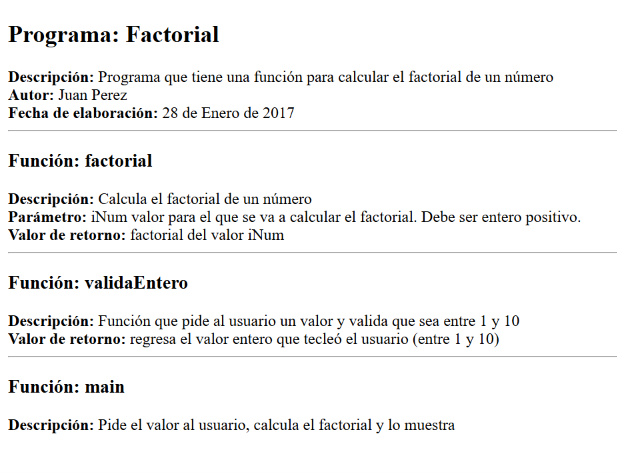

# cpp-html-documentation-generator

Programa en C++ que lee un archivo `.cpp`, extrae los comentarios de documentación escritos entre `/**` y `*/` y genera una página `.html` con esa información (programa, funciones, parámetros y valores de retorno). Es una versión simplificada de herramientas como Doxygen o Javadoc.




## Etiquetas soportadas

| Etiqueta    | Se muestra como         | Ejemplo                                   |
|-------------|-------------------------|-------------------------------------------|
| `@progName` | Título del programa     | `@progName Factorial`                     |
| `@desc`     | Descripción             | `@desc Calcula el factorial de un número` |
| `@author`   | Autor                   | `@author Juan Perez`                      |
| `@date`     | Fecha de elaboración    | `@date 28 de Enero de 2017`               |
| `@funcName` | Encabezado de función   | `@funcName factorial`                     |
| `@param`    | Parámetro               | `@param iNum valor a calcular`            |
| `@return`   | Valor de retorno        | `@return factorial de iNum`               |

Cada etiqueta va en su propia línea. Se aceptan tres estilos de bloque:

```cpp
/**
@desc Estilo simple
*/

/**
 * @desc Estilo con asterisco y sangría
 */

/** @desc Bloque de una sola línea */
```

## Requisitos

- Un compilador de C++ con soporte para C++11 (por ejemplo `g++` 5 o superior).

## Compilar

```bash
g++ -std=c++11 -Wall -Wextra -o doc_generator src/doc_generator.cpp
```

En Windows con MinGW el ejecutable será `doc_generator.exe`.

## Ejecutar

El programa busca el `.cpp` en el **directorio actual** y crea el `.html` en el mismo lugar. Para probarlo con los ejemplos:

```bash
cd examples
../doc_generator
```

### Ejemplo de entrada y salida

```text
Ingresa el nombre del archivo a documentar (sin .cpp): ejFactorial
Documentacion generada: ejFactorial.html
```

Fragmento de `examples/ejFactorial.cpp`:

```cpp
/**
@funcName factorial
@desc Calcula el factorial de un número
@param iNum valor para el que se va a calcular el factorial. Debe ser entero positivo.
@return factorial del valor iNum
*/
```

HTML generado (`examples/ejFactorial.html`):

```html
<hr>
<h3>Funci&oacute;n: factorial</h3>
<strong>Descripci&oacute;n:</strong> Calcula el factorial de un número<br>
<strong>Par&aacute;metro:</strong> iNum valor para el que se va a calcular el factorial. Debe ser entero positivo.<br>
<strong>Valor de retorno:</strong> factorial del valor iNum<br>
```

Si el archivo no existe, el programa muestra un mensaje, termina con código `1` y **no** crea ningún `.html`.

## Estructura del repositorio

```text
.
├── src/doc_generator.cpp     Código fuente
├── examples/
│   ├── ejFactorial.cpp/.html Ejemplo con varias funciones
│   ├── escobedo.cpp/.html    Ejemplo mínimo (solo encabezado)
│   └── casos_borde.cpp/.html Estilos de bloque, acentos y caracteres especiales
├── .gitignore
├── LICENSE
└── README.md
```

## Known limitations

- **Descripciones de varias líneas:** cada etiqueta debe caber en una sola línea; las líneas de continuación se ignoran.
- **Etiquetas desconocidas:** cualquier etiqueta distinta de las de la tabla se ignora sin avisar.
- **Orden:** el HTML respeta el orden en que aparecen las etiquetas en el `.cpp`.
- **No analiza el código:** solo lee los comentarios; no verifica que `@param` coincida con los parámetros reales de la función.
- **Texto `/**` dentro de cadenas o comentarios normales:** se interpreta como inicio de bloque.
- **Solo directorio actual:** no acepta rutas; hay que ejecutar el programa en la carpeta del `.cpp`.
- **Sin estilos:** el HTML generado no incluye CSS.

## Posibles mejoras

- Soporte para descripciones multilínea.
- Recibir el archivo como argumento de línea de comandos (`./doc_generator archivo.cpp`).
- Hoja de estilos CSS y un índice de funciones.

## Licencia

MIT. Consulta el archivo [LICENSE](LICENSE).
